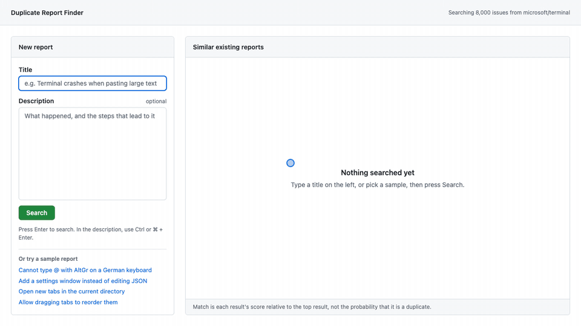
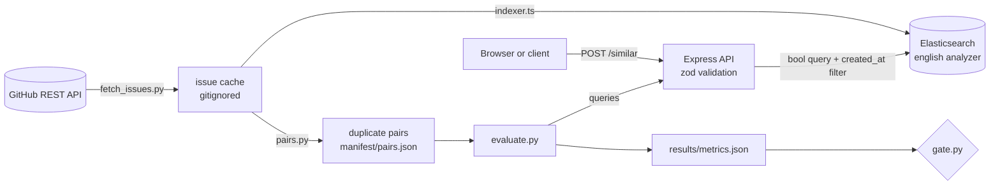

<div align="center">

# dupBug

**Find out whether a bug has already been reported, before it is filed again.**

A search service over real GitHub issues, with an evaluation harness that measures it against duplicates confirmed by
the project's own maintainers.

[](https://github.com/hitesh-ctrl/dupBug/actions/workflows/ci.yml)




</div>

## Overview

Large open-source projects receive the same bug report many times. Maintainers spend time finding the earlier report
and closing the new one as a duplicate. dupBug takes a new report (title and description) and returns the ten existing
issues most likely to describe the same problem, so the reporter or a triager can check before a duplicate is filed.

The interesting part is not the search itself but how it is measured. Ground truth comes from issues that maintainers
of [microsoft/terminal](https://github.com/microsoft/terminal) closed as duplicates, checked by hand, and the
evaluation is built so that it cannot accidentally see the future.

## Results

<!-- RESULTS:START (generated by scripts/render_readme.py, do not edit) -->
On duplicates it never saw during tuning, the issue it was closed as a duplicate of is in the top 10 results **30.7%** of the time, 1.7× the rate of a plain title search (17.7%).

| Metric | Held-out (n=566) | Baseline | Tuning (n=1320) | Baseline |
|:--|--:|--:|--:|--:|
| Hit@5 | **22.1%** | 14.0% | 29.5% | 17.4% |
| Hit@10 | **30.7%** | 17.7% | 37.9% | 24.6% |
| MRR | **0.143** | 0.098 | 0.197 | 0.121 |

<sub>Data: 8,000 issues from <code>microsoft/terminal</code> (2017-08-12 to 2021-06-13), 1,886 verified duplicate pairs, split by time. Baseline: title-only match with Elasticsearch defaults. Label accuracy (manual check): 28/30. Planted bugs caught: 3/3 on the first pass, 3/3 after adding tests. Local latency of <code>/similar</code>: p50 3.6 ms, p95 6.2 ms (same machine, sequential, n=1,886). Generated from <code>results/</code> on 2026-11-17.</sub>
<!-- RESULTS:END -->

**Hit@k** is the share of duplicates whose original appears in the top *k* results; **MRR** rewards ranking it first.
Definitions with worked examples are in [docs/NOTES.md](docs/NOTES.md).

## How it works



- **Indexing.** Titles and descriptions are indexed with Elasticsearch's English analyzer (stemming, stop words).
  HTML comments, which hold the repository's issue template, are stripped first; that change alone gave the largest
  gain in tuning.
- **Querying.** Four weighted `match` clauses (title→title, title→description, description→description,
  description→title). User text is only ever a value in a `match` clause, never `query_string` or raw JSON.
- **No looking into the future.** Every query carries a `created_at < before` filter. During evaluation `before` is the
  duplicate's own creation time, so a query can never return itself or a later report. A dedicated test fails if it does.

## Evaluation

| Step | What it guards against |
|:--|:--|
| **Pairs extracted from maintainer comments** (`duplicate of #N`), kept only if the original is older and unambiguous | Trusting labels that point nowhere or to several issues |
| **Manual spot check** of a random sample ([docs/LABEL_CHECK.md](docs/LABEL_CHECK.md)) | Noisy ground truth going unnoticed |
| **Split by time**: tune on the oldest 70%, report the newest 30% once | Tuning on the test set; leakage between bug "waves" |
| **Naive baseline** reported next to every number | Gains that come from the data rather than the system |
| **Regression gate** (`eval/gate.py`) in CI: fails on an MRR drop over 0.02 or any previously-found pair being lost | Silent ranking regressions |
| **Planted bugs** behind flags, run against the suite ([docs/PLANTED_BUGS.md](docs/PLANTED_BUGS.md)) | A test suite that passes no matter what |

What was and was not tested, and the known limits, are in [docs/FINAL_REPORT.md](docs/FINAL_REPORT.md).

## Getting started

**Requirements:** macOS or Linux, Node 22, Python 3.12, `curl`, about 1.5 GB of disk. No Docker needed.

```bash
git clone https://github.com/hitesh-ctrl/dupBug.git && cd dupBug
npm ci
python3.12 -m venv .venv && .venv/bin/pip install -r requirements.txt

scripts/es_setup.sh        # downloads Elasticsearch 8.19.25, verifies its SHA-512, configures it
scripts/es_start.sh        # starts it on 127.0.0.1:9200 and waits for health

cp .env.example .env       # add a GitHub token with read-only access to public repositories
.venv/bin/python scripts/fetch_issues.py --from-manifest
npm run index

npm start                  # http://127.0.0.1:3187
```

> [!NOTE]
> The local Elasticsearch runs with security disabled and is bound to `127.0.0.1`. It is meant for development
> only and must not be exposed to a network.

## API

```bash
curl -s -X POST http://127.0.0.1:3187/similar \
  -H 'Content-Type: application/json' \
  -d '{"title": "Terminal crashes when pasting large text", "body": "The window closes after a big paste"}'
```

Response shape (up to 10 results, most similar first):

```ts
{ results: Array<{ number: number; title: string; url: string; created_at: string; score: number }> }
```

| | |
|:--|:--|
| Body | `title` (1–200 characters), `body` (0–5,000, optional). Unknown fields are rejected. |
| Query | `before` (optional, ISO-8601): search only issues created before this instant. Default: now. |
| Errors | `400 invalid_request`, `413 payload_too_large`, `429 rate_limited` (if enabled), `503 search_unavailable`. No stack traces. |

## Testing

```bash
npm test                              # API tests against a real Elasticsearch
.venv/bin/python -m pytest eval -q    # metric, extraction and gate unit tests
scripts/run_eval.sh --final           # full evaluation -> results/metrics.json, results/failures.json
.venv/bin/python eval/gate.py         # regression gate against results/baseline.json
```

CI runs all of the above on every push, with Elasticsearch as a service container.

## Project structure

```
src/         API, query builder, indexer, search parameters
public/      the web page (single HTML file, no build step)
tests/       API and query tests (vitest, supertest)
eval/        pair extraction, evaluation, regression gate, unit tests (pytest)
scripts/     Elasticsearch setup, data fetch, evaluation runners, README and demo generation
manifest/    issue numbers and duplicate pairs (numbers only; issue text is never committed)
results/     every measured number, as JSON
docs/        methodology notes, label check, planted bugs, final report, deployment guide
deploy/      setup script for a small Ubuntu VM
```

## Limitations

- **One repository.** Parameters were tuned on `microsoft/terminal`; nothing is known about other projects.
- **Keyword search only.** Reports that describe the same root cause in different words are often missed.
- **Strict scoring.** Only the issue the maintainer named counts as a hit, even if another earlier report of the
  same bug is returned.
- **Local measurements.** Latency was measured on one machine; there is no hosted deployment.

## Data

Issue text comes from the public GitHub API and stays in a local, gitignored cache. The repository commits only issue
numbers ([manifest/](manifest)), so the exact data set can be re-downloaded with `fetch_issues.py --from-manifest`.
